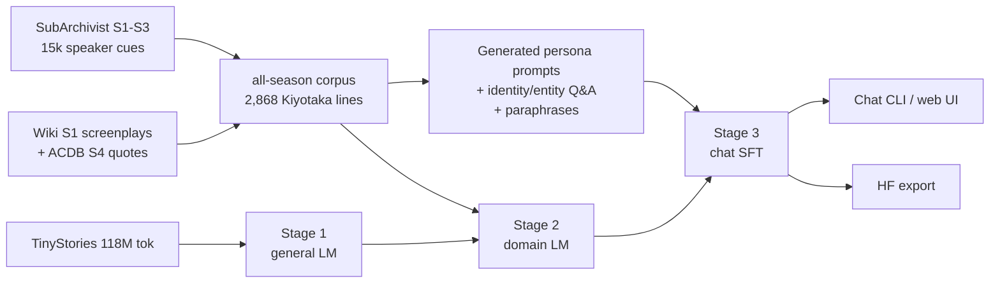

# Kiyotaka — a character LLM trained from scratch on a laptop

A **~52M-parameter decoder-only transformer** that role-plays **Kiyotaka Ayanokoji**
from *Classroom of the Elite*. Everything is built from zero: the tokenizer, the
architecture, the corpus, the chat format and the training loop. No pretrained
weights are loaded at any stage.

Trained end-to-end on a single **RTX 4050 Laptop (6 GB VRAM)**.
Weights: [AAJ007/kiyotaka-ayanokoji-56m](https://huggingface.co/AAJ007/kiyotaka-ayanokoji-56m).

```
You: What do you think about friendship?
Kiyotaka: A useful arrangement, as long as both sides know what it is.
```

## Architecture

| Component | Choice |
|---|---|
| Layers | 10 |
| Model width | 640 |
| Heads / KV heads | 10 / 5 (GQA) |
| FFN | SwiGLU, 1792 |
| Positions | RoPE, θ=10000 |
| Norm | RMSNorm (pre-norm) |
| Embeddings | tied input/output |
| Vocab | 8192 byte-level BPE, trained here |
| Context | 512 tokens |
| Params | 51.95M |
| Attention | `F.scaled_dot_product_attention` (flash kernel) |

## Data (web-sourced)

| Source | What it gives | Volume |
|---|---|---|
| [SubArchivist](https://subs.yakuaru.com/books/classroom-of-the-elite) | per-cue speaker-labelled Crunchyroll subtitles, S1–S3 | 15,152 cues |
| [You-Zitsu wiki screenplays](https://you-zitsu.fandom.com/wiki/Episode_1/Screenplay) | S1 transcripts with monologues + stage directions | 12 episodes |
| [ACDB](https://www.animecharactersdatabase.com/quotesbyseries.php?pid=111971) | S4 quote cues with episode metadata | 43 quotes |
| You-Zitsu character pages | identity, class, personality facts | 15 characters |
| [TinyStories](https://huggingface.co/datasets/roneneldan/TinyStories) | general English pretraining | 118M tokens |

After merging and deduplication: **2,868 unique Ayanokoji lines** across S1–S4,
plus 12k+ lines from other characters for dialogue grounding and ~2 MB of wiki
prose for setting/relationships. Raw data is **not redistributed** (`data/` is
git-ignored).

## Pipeline



* **Stage 1 — language:** 52M tokens of TinyStories from random weights.
* **Stage 2 — domain:** ~751k tokens of all-season dialogue + wiki prose, with
  chat-template warm-up.
* **Stage 3 — character:** ~3.6k chat pairs. Assistant targets are canon lines or
  curated in-character answers; only the user side is synthetic.
* **Inference memory (optional):** an offline MiniLM index over the curated Q&A.
  Near-exact intents return the vetted answer; weaker matches are injected as a
  single in-context example. Fully local, no API.

## Results

**Training loss / held-out perplexity**

| Stage | Val loss | Perplexity |
|---|---|---|
| 1. general (TinyStories) | 1.633 | 5.12 |
| 2. domain (all seasons) | 3.002 | 20.11 |
| 3. character SFT (chat val) | 3.29 | — |
| SFT on CoTE test text | 3.47 | 32.18 |

**Character eval** — 60 held-out prompts, local Qwen2.5-1.5B judge, 1–5 scale

| System | Fidelity | Coherence | Mean words | Distinct-2 |
|---|---|---|---|---|
| domain base | 2.67 | 3.32 | 15.6 | 0.760 |
| SFT | **3.07** | 3.27 | 9.3 | 0.582 |
| SFT + retrieval memory | 3.02 | **3.35** | 10.4 | 0.678 |

Human-readable outputs: [`reports/samples.md`](reports/samples.md).

**Performance** (RTX 4050 Laptop, 6 GB; 52M params, fp32)

| Mode | Prefill | Decode |
|---|---|---|
| GPU, batch 1 | 6.4 ms | 277 tok/s |
| GPU, batch 4 | 6.7 ms | 1,067 tok/s |
| GPU, batch 8 | 11.0 ms | 1,887 tok/s |
| CPU, fp32, batch 1 | 25.7 ms | 94 tok/s |
| CPU, dynamic int8 | — | 322 tok/s (20 MB weights) |

Peak VRAM: 275 MB allocated / 444 MB reserved. Full JSON:
[`reports/eval_56m.json`](reports/eval_56m.json),
[`reports/benchmark_56m.json`](reports/benchmark_56m.json).

## Quickstart

```bash
uv venv --python 3.12 .venv
uv pip install --python .venv/bin/python -r requirements.txt

# data (network; raw data stays git-ignored)
.venv/bin/python scripts/scrape_data.py
.venv/bin/python scripts/scrape_subarchivist.py
.venv/bin/python scripts/scrape_acdb.py --seasons 4 --max-pages 40
.venv/bin/python scripts/build_corpus_v2.py
.venv/bin/python scripts/gen_persona.py --per-line 2
.venv/bin/python scripts/filter_pairs.py data/processed/synth_persona_v2.jsonl
.venv/bin/python scripts/gen_identity_qa.py
.venv/bin/python scripts/paraphrase_questions.py
.venv/bin/python scripts/build_sft.py --config configs/sft_sources_clean.json
.venv/bin/python scripts/prepare_data_v2.py

# train 52M from scratch
.venv/bin/python scripts/train.py --config configs/pretrain_general_56m.json --out checkpoints/pretrain_56m
.venv/bin/python scripts/train.py --config configs/pretrain_domain_56m.json --out checkpoints/domain_56m
.venv/bin/python scripts/sft.py --config configs/sft.json --ckpt checkpoints/domain_56m/best.pt \
  --out checkpoints/sft_56m --epochs 2 --lr 1e-4 --dropout 0.1
.venv/bin/python scripts/build_rag_index.py

# chat
.venv/bin/python scripts/chat.py --ckpt checkpoints/sft_56m/best.pt
.venv/bin/python scripts/serve.py --ckpt checkpoints/sft_56m/best.pt --port 8000
```

## Repository layout

```
src/kiyotaka/       model, tokenizer, data, inference, retrieval
scripts/            scrape -> merge -> generate -> train -> SFT -> eval -> export
configs/            model/data/training configuration
data/manual/        small curated persona seed (committed)
data/raw, processed web data and tokenised bins (git-ignored)
reports/            evaluation and benchmark JSON
checkpoints/        weights (git-ignored)
```

## Limitations

Small by design. It has no knowledge beyond the corpus, can hallucinate, and may
repeat lines from the show. The 52M raw model is terse and occasionally swaps
character names; retrieval memory covers common identity/relationship questions.
Fan/research artifact; the character and source material belong to their rights
holders. Do not redistribute the scraped corpus.
